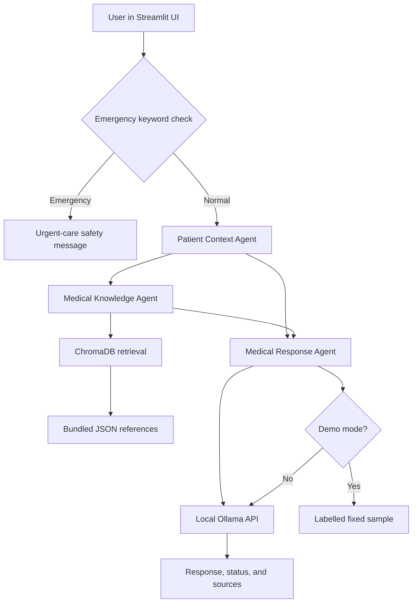

# MediMind AI

MediMind AI is a local-first educational prototype demonstrating a three-agent medical-information workflow, local retrieval-augmented generation (RAG), and synthetic patient memory. It is for college-project demonstration and general health education only; it is not a diagnostic, treatment, or emergency-care system.

## Features

- Streamlit medical assistant, patient profile, and knowledge-base views.
- Three sequential LangGraph agents: Patient Context, Medical Knowledge, and Medical Response.
- Bundled JSON medical references retrieved through ChromaDB and Sentence Transformers.
- SQLite persistence for synthetic patient profiles and consultation history.
- Local Ollama inference using `smollm2:360m` at `http://127.0.0.1:11434`.
- Explicitly labelled fixed-response demo mode.
- Localhost-only model API restriction; remote model hosts are rejected.
- Emergency-keyword guard and response-safety filtering.

## Technology stack

Python 3.11+ (Python 3.12 was used for the tested Windows setup), Streamlit, LangGraph, ChromaDB, Sentence Transformers, Ollama, SQLite, SQLAlchemy, python-dotenv, and pytest.

## Architecture



The generated SQLite database, Chroma index, embedding cache, and Ollama model store live under `data/` during local execution and are excluded from version control.

## Project structure

```text
.
├── app.py                         # Streamlit application
├── config.py                      # Paths and environment defaults
├── requirements.txt               # Python dependencies
├── SETUP_GUIDE.md                 # Detailed setup guide
├── run.bat                        # Windows launcher
├── agents/                        # Patient, knowledge, and response agents
├── graph/                         # Shared state and LangGraph workflow
├── rag/                           # Ingestion, embeddings, and retrieval
├── database/                      # SQLAlchemy models and SQLite operations
├── services/                      # Ollama client
├── knowledge_base/                # Bundled JSON references
├── presentation_assets/           # UI screenshots
├── tests/                         # Automated tests
├── .env.example                   # Safe configuration template
└── generate_report.py             # Report-generation utility
```

## Prerequisites

- Windows, macOS, or Linux.
- Python 3.11 or newer; Python 3.11 is recommended for ChromaDB compatibility.
- Internet access for initial dependency and embedding-model downloads.
- Ollama is optional for demo mode and required for live local responses.

## Installation

```powershell
git clone https://github.com/ProfOP/MediMind-AI.git
Set-Location MediMind-AI
py -3.11 -m venv .venv
New-Item -ItemType Directory -Force .cache\pip, .tmp, .localhome | Out-Null
$env:PIP_CACHE_DIR = "$PWD\.cache\pip"
$env:TEMP = "$PWD\.tmp"
$env:TMP = $env:TEMP
.\.venv\Scripts\python.exe -m pip install --upgrade pip
.\.venv\Scripts\python.exe -m pip install -r requirements.txt
```

Python 3.12 is the tested fallback if Python 3.11 is unavailable.

## Environment variables

Copy `.env.example` to `.env` if customization is needed. Supported variables:

| Variable | Default | Purpose |
|---|---|---|
| `OLLAMA_BASE_URL` | `http://127.0.0.1:11434` | Local Ollama endpoint |
| `OLLAMA_MODEL` | `smollm2:360m` | Ollama model |
| `MEDIMIND_EMBEDDING_MODEL` | `sentence-transformers/all-MiniLM-L6-v2` | Embedding model |
| `MEDIMIND_DB_PATH` | `data/medimind.sqlite3` | Optional database path |

Never commit `.env`, credentials, API keys, or real patient information. Remote Ollama hosts are rejected by the application.

## Ollama setup

Install Ollama from its official website. Then use the project-local model directory:

```powershell
New-Item -ItemType Directory -Force data\ollama\models | Out-Null
$env:OLLAMA_MODELS = "$PWD\data\ollama\models"
ollama serve
```

In a second terminal:

```powershell
$env:OLLAMA_MODELS = "$PWD\data\ollama\models"
ollama pull smollm2:360m
ollama list
```

## Run

```powershell
$env:HOME = "$PWD\.localhome"
$env:XDG_CACHE_HOME = "$PWD\.cache"
$env:STREAMLIT_CONFIG_DIR = "$PWD\.streamlit"
$env:TEMP = "$PWD\.tmp"
$env:TMP = $env:TEMP
$env:STREAMLIT_BROWSER_GATHER_USAGE_STATS = "false"
.\.venv\Scripts\python.exe -m streamlit run app.py --server.address 127.0.0.1 --server.port 8501
```

Open http://127.0.0.1:8501. Use port 8502 if 8501 is occupied. For a no-Ollama demonstration, enable **Use labelled demo mode** in **Session settings**. With demo mode disabled, Ollama failures are reported rather than replaced with a fake response.

## Usage

- Ask general health-information questions in **Medical assistant**.
- Create synthetic profiles in **Patient profile**; do not enter real identifiers.
- Browse and search local references in **Knowledge base**.
- Expand **Agent execution and sources** to inspect agent status and references.

## Testing

```powershell
.\.venv\Scripts\python.exe -m pytest tests -q
```

Tests use temporary SQLite/Chroma stores and mocked embeddings/Ollama calls. Ollama is not required for the automated suite.

## Screenshots

Example UI screenshots are included in `presentation_assets/`. Do not claim a screenshot represents a feature that is not present.

## Limitations and future scope

This is a small educational prototype, not a clinically reviewed knowledge base or secure medical-record system. Potential future work includes broader validated references, stronger privacy controls, richer evaluation metrics, improved emergency detection, and deployment packaging.

## Contributing

Keep changes focused, add or update tests where appropriate, document new configuration, and never commit credentials, model caches, generated databases, or real patient information.

## License

No license file is currently included. Add an explicit license before distributing the repository under open-source terms.

## Safety notice

MediMind AI provides general healthcare information for educational purposes only. It does not diagnose, prescribe medication, recommend doses, or direct treatment changes. Consult a qualified healthcare professional for personal concerns; contact local emergency services in an emergency.
